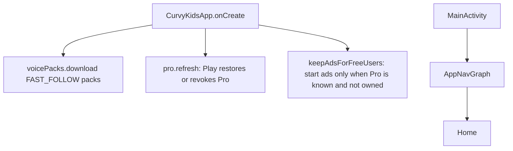
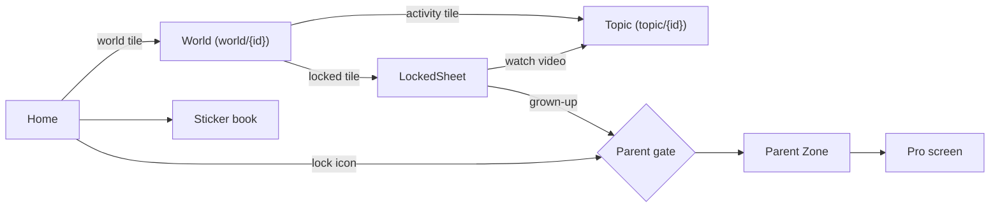
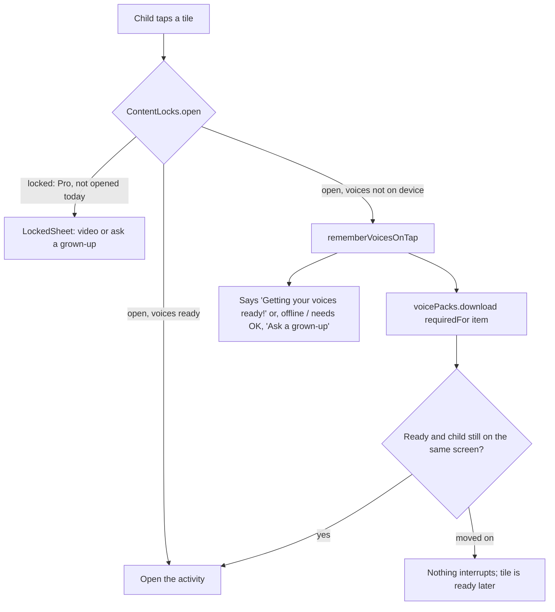
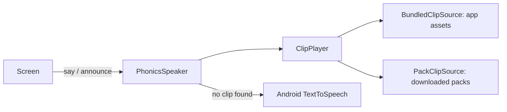

# CurvyKids: developer guide

How the app is built, how its parts fit together, and how to build, run and test each part.
The project rules in `CLAUDE.md` still apply. Diagrams are Mermaid; GitHub and Android Studio's
Markdown preview render them.

---

## 1. What the app is

CurvyKids is an offline-first learning app for young children (Android, Jetpack Compose).

- **Six worlds**, each with its own activities (`data/content/Worlds.kt`):

| World | Activities (topic ids) |
|---|---|
| Letters | upper, lower, phonics, words, rhyming, opposites |
| Numbers | numbers, count, addition, subtraction, shapes, patterns, bigsmall, fractions, time |
| Hindi | hindi_vowels, hindi_consonants, barakhadi, stories |
| Animals | animals, birds, sea, insects, nature, weather, seasons, fruitsveggies |
| My World | body, emotions, colors, food, clothes, toys, instruments, home, jobs, places, sports, vehicles, days, months |
| Games | memory, oddone, catch, draw |

- **Voice everywhere.** Every line is a recorded clip when one exists. Otherwise the phone's
  text-to-speech says it.
- **Tracing** of English and Hindi letters, checked on the device by ML Kit Digital Ink.
- **CurvyKids Pro**, a one-time purchase, unlocks everything. Each world keeps a free part.
  Free users can open one locked item until midnight by watching a video.
- **Grown-up areas** sit behind a parent gate: the Parent Zone, the Pro screen, buying and settings.
  The gate asks a sum written in words, for example "twenty-three plus forty-eight".

---

## 2. Project layout

```
curvy-kids/
├── app/                      the app module
│   └── src/main/
│       ├── java/com/vi5hnu/curvykids/   code (see below)
│       └── assets/
│           ├── voice/en/{lines,phonemes}/   recordings built into the app
│           ├── kids/…                         our own SVG art (icons, pictures)
│           └── *.lottie                        loading / error animations
├── voice_hi_letters/         asset pack: Hindi vowels + consonants      (fast-follow)
├── voice_hi_barakhadi/       asset pack: free Barakhadi letters क–ङ     (fast-follow)
├── voice_pro_letters/        asset pack: Letters world Pro voices        (on-demand)
├── voice_pro_numbers/        asset pack: Numbers world Pro voices        (on-demand)
├── voice_pro_nature/         asset pack: Animals world Pro voices        (on-demand)
├── voice_pro_my_world/       asset pack: My World Pro voices             (on-demand)
├── voice_pro_hindi/          asset pack: Pro Barakhadi letters + stories (on-demand)
├── tools/                    LOCAL ONLY, git-ignored (voice + art generation scripts)
├── local.properties          LOCAL ONLY: sdk.dir, play.licenseKey, admob.appId
└── curvy-kids.jks / key.properties   LOCAL ONLY: release signing
```

Code packages under `app/src/main/java/com/vi5hnu/curvykids/`:

| Package | What lives there |
|---|---|
| `CurvyKidsApp.kt` | App singletons: voice packs, Pro, ads, access, connectivity, clip sources |
| `MainActivity.kt` | Hosts the Compose nav graph |
| `data/content` | All content: topics, worlds, words, pictures, stories, voice scripts (`EnglishVoiceScript`, `HindiVoiceScript`, `TopicVoices`) |
| `data/app`, `data/progress` | DataStore: stars, streak, badges, difficulty, tracing progress |
| `audio` | `PhonicsSpeaker` (clips first, then TTS, ordering and waiting), `ClipSources`, sound effects |
| `audio/packs` | Play Asset Delivery: `VoicePack`, `PlayVoicePackRepository`, `PackState`, `VoiceReadiness` |
| `billing` | Pro: `ProCatalog` (free/Pro split), `Access`/`ContentLocks`, Play and fake repositories, purchase verification |
| `ads` | Rewarded videos (AdMob) and `AdUnlocks` (what a video opened for today) |
| `recognition` | ML Kit Digital Ink handwriting recognition |
| `ui/navigation` | `AppNavGraph`, routes (`Screen`), leaving after speech, voices-on-tap |
| `ui/home`, `ui/world`, `ui/activities`, `ui/trace`, `ui/game` | Screens |
| `ui/parent`, `ui/pro` | Parent gate, Parent Zone, Pro screen, locked sheet, notices |
| `ui/kit`, `ui/components`, `ui/theme` | Shared UI building blocks and theme |

---

## 3. How it fits together

### App start



### Navigation



Routes are in `ui/navigation/Screen.kt`. Every tap on a lockable item goes through
`ContentLocks.open(item)`, so the lock and voice rules live in one place.

### Tapping an item: locks and voices



- `ProCatalog` decides what is free. Free activities: upper, lower, numbers, count, shapes,
  hindi_vowels, animals, birds, colors, body, draw and memory. Barakhadi and stories are partly
  free: the first 5 consonants (क ख ग घ ङ) and the first story.
- `Access` combines Pro ownership, whether it's known yet, and today's video unlocks.
  - Until Play answers, items show a shimmer instead of a padlock.
- `LockMark` is what a tile draws:
  - NONE, LOADING (a shimmer), LOCKED (a padlock), OPEN_TODAY (opened by a video);
  - GettingReady (a progress ring);
  - NEEDS_GROWN_UP (a cloud).

### Voice



- Each line has a key. The clip lives at `assets/voice/<lang>/<group>/<key>.m4a`.
- `PhonicsSpeaker.speaking` is a StateFlow, and `awaitQuiet()` waits for the current line.
  Activities call it before moving to the next question, so the voice is never cut off.
- Back while the voice is talking waits for the line to end, and the button pulses meanwhile.
  A second tap leaves at once (`ui/navigation/LeaveAfterSpeech.kt`).

### Voice packs (Play Asset Delivery)

| Pack | Delivery | Who gets it |
|---|---|---|
| voice_hi_letters, voice_hi_barakhadi | fast-follow | Everyone, right after install |
| voice_pro_* (5 packs, one per world) | on-demand | Only when an open Pro item is tapped, or "Download" in the Parent Zone |

- **Where a clip lives is decided by code, never by hand:** `VoicePack.homeOf(clip)`.
  - An English clip goes in a world's Pro pack only if Pro activities of that one world are
    the only ones that say it.
  - Anything a free activity says, or two worlds share, stays in the app.
- **`VoicePack.requiredFor(topic | item)`** gives the packs an item can't open without.
- **Built-in packs:** each pack module ships a marker file `assets/packs/<packName>`. A debug
  build bundles every pack, and the marker tells the app the pack is already there.
- **Sizes (arm64):**
  - Free user: about 16.6 MB.
  - Pro family with every pack: about 32 MB.

### Pro and billing

- `ProRepository` has two implementations, chosen in `CurvyKidsApp`:
  - **`PlayProRepository`** (release, or debug with `-PrealBilling=true`): real Play Billing.
    Purchases are verified with `play.licenseKey` (`PurchaseVerifier`).
  - **`FakeProRepository`** (debug, by default): a stand-in store offering ₹299, with a ₹199
    launch offer. "Buying" unlocks at once, and the purchase is remembered across restarts.
- Product id: `curvykids_pro` (`ProCatalog.PRODUCT_ID`). Setup steps are in the Play Console
  notes (release.txt, kept locally).

### Ads

- AdMob rewarded videos run only for free users, set as child-directed and rated G.
- Debug builds use Google's sample app id and test unit, so no real ad ever shows.
- `AdUnlocks` remembers what was opened today. It is protected against setting the clock back
  (it checks the boot count).

---

## 4. Setup

1. Open the project in Android Studio. The build needs the bundled JDK 17+:
   ```
   export JAVA_HOME="/Applications/Android Studio.app/Contents/jbr/Contents/Home"
   ```
2. `local.properties` (never commit it):
   ```
   sdk.dir=/Users/<you>/Library/Android/sdk
   play.licenseKey=<Base64 key from Play Console > Monetization setup > Licensing>
   admob.appId=<ca-app-pub-…~…>
   ```
   Debug builds work without the last two. A release build fails on purpose if either is missing.
3. For release signing you need `curvy-kids.jks` and `key.properties`. Both are git-ignored;
   get them from the owner.

---

## 5. Build and run

| Goal | Command |
|---|---|
| Debug APK (every voice pack bundled, fake Pro) | `./gradlew :app:assembleDebug` |
| Install on the emulator | `adb -s emulator-5554 install -r app/build/outputs/apk/debug/app-debug.apk` |
| Debug with real Play billing | `./gradlew :app:assembleDebug -PrealBilling=true` (works only when installed from a Play test track) |
| Watch the fake launch offer end in 60 s | `./gradlew :app:assembleDebug -PfakeOfferEnds=60` |
| Release bundle for Play | `./gradlew :app:bundleRelease` → `app/build/outputs/bundle/release/app-release.aab` (upload the .aab, never an APK, or the voice packs aren't delivered) |

Before each Play upload, raise `versionCode` in `app/build.gradle.kts`.

---

## 6. How to test things

The unit tests are content and integrity checks. Behaviour is checked by hand on an emulator.

### Unit tests

```
./gradlew :app:testDebugUnitTest
```

| Test | Checks |
|---|---|
| `TopicIntegrityTest`, `WorldsTest`, `TopicPicksTest` | Every topic belongs to a world, and content lists are consistent |
| `AssetExistenceTest`, `NoEmojiArtTest` | Every picture referenced exists as our own SVG, and no emoji is used as art |
| `EnglishVoiceScriptTest`, `VoiceScriptTest` | Voice keys are valid. Writes `tools/voice/recording_list.txt` (what needs recording) and checks every recording is in its pack module (writes `tools/voice/pack_moves.txt` if not) |
| `VoicePackTest` | Clip homes (letters, barakhadi, stories), and that free topics need no on-demand pack |
| `LetterExamplesTest`, `BarakhadiHintsTest`, `PhonicsQuizTest`, `PatternsTest`, `QuizRulesTest` | Content and quiz rules |
| `MasteryProgressTest`, `StreakTest` | Progress and streak maths |
| `GateQuestionTest` | The parent-gate question |
| `CharacterMatcherTest` | Handwriting result matching |
| `VoicePackPanelTest` | Parent Zone pack panel text |

### Useful logcat tags

```
adb -s emulator-5554 logcat -s VOICE_PACKS CLIPS PHONICS PRO_BILLING PRO_VERIFY CURVY_ADS MLKIT
```

### Reset to a fresh install (also clears fake Pro)

```
adb -s emulator-5554 shell pm clear com.vi5hnu.curvykids
```

### Free user vs Pro (debug)

1. After a fresh install the user is free. Pro tiles show a padlock.
2. Tap Home's lock, solve the gate, then Parent Zone → Pro → Buy. The fake store unlocks at once.
3. Kill and reopen the app: Pro must still be there.
4. To be a free user again, use `pm clear` (above).

### Video unlock (free user, debug)

1. Tap a locked tile. The LockedSheet opens; watch the test video to the end.
2. The tile shows the "open today" mark and opens.
3. It stays open until midnight. Setting the clock back must not bring an expired unlock back.

### Voice timing

- In a quiz, answer correctly. The next question must appear only after the praise has finished.
- Tap Back while a line plays. The button pulses and the screen leaves when the line ends.
  A second tap leaves at once.
- Stories and Barakhadi recitations stop at once on Back.

### Pro voices downloading on demand (real Play Asset Delivery)

A plain debug APK bundles every pack, so it never downloads anything. To try the real flow,
use bundletool's local testing:

```
./gradlew :app:bundleDebug -Pvoice.bundled=false
bundletool build-apks --local-testing \
  --bundle=app/build/outputs/bundle/debug/app-debug.aab --output=local.apks
adb -s emulator-5554 uninstall com.vi5hnu.curvykids
bundletool install-apks --apks=local.apks --device-id=emulator-5554
```

Then check:

- **Free user:** Pro tiles show the padlock, and `logcat -s VOICE_PACKS` shows no Pro pack fetched.
- **Pro user taps a Pro tile** (for example Letter Sounds):
  - a ring fills on the tile, and the voice says "Getting your voices ready!";
  - the activity opens by itself if the child is still on that screen.
- **Tap a Pro tile and go play something else.** Nothing interrupts the child, and the tile is
  ready when they come back.
- **Free user after a video:** that item's pack downloads, then it opens.
- **Parent Zone → Download:** every Pro pack reaches Ready.
- **Wi-Fi off:** the tile shows a cloud, and the voice says "Ask a grown-up to help".

### Real billing (before a release)

1. Upload to the internal testing track and add license testers.
2. Install from Play, not adb.
3. Check each of these:
   - buy;
   - kill and reopen;
   - uninstall and reinstall restores Pro;
   - a refund removes Pro on the next start;
   - a slow test card stays pending, then unlocks.

### Handwriting

Trace a letter in Upper Case and then in Hindi vowels. The first time, ML Kit downloads the
language model, so the device needs internet once. After that it works offline.

---

## 7. Common tasks

### Add an activity

1. Add the `Topic` in `data/content/TopicData.kt` (TOPICS) with a `TopicKind`.
2. Add its id to a world's `topicIds` in `Worlds.kt`, and its tile art in `TOPIC_ART`.
3. Add or reuse its screen in `ui/activities`, and route its `TopicKind` in `AppNavGraph`.
4. If it should be free, add it to `ProCatalog.FREE_TOPIC_IDS`.
5. List its spoken lines in `TopicVoices.clipsFor`, so its clips land in the right pack.
6. Run the unit tests. They name any missing art, voice keys or misplaced clips.

### Add or record voice lines

1. Add the line to `EnglishVoiceScript` or `HindiVoiceScript`.
2. Run the unit tests. They regenerate `tools/voice/recording_list.txt`.
3. Record the clips with the local script `tools/voice/generate_voice.py`, which uses Gemini TTS.
   - Pass the API key only as an env var for that command; never write it to a file.
   - The script is local-only. Never delete or overwrite existing clips without checking first.
4. New clips land in `app/`. If `VoiceScriptTest` says some belong in a pack, run the
   `git mv` lines it wrote to `tools/voice/pack_moves.txt`.

### Change what is free

Edit only `billing/ProCatalog.kt`. The locks, packs and badges all follow from it. Then run the
tests, because clip homes may move and `VoiceScriptTest` will list those moves.

### Add a voice pack

1. Add a Gradle module like `voice_pro_letters`, with `build.gradle.kts`, the asset-pack plugin
   and a delivery type.
2. Give it the marker file `src/main/assets/packs/<module>`.
3. Include it in `settings.gradle.kts` and in the `voicePacks` list in `app/build.gradle.kts`.
4. Add the entry in `audio/packs/VoicePack.kt`.

---

## 8. Rules worth knowing

- Art is our own SVG assets: never from the internet, never drawn in code. The letter
  shown in trace and Barakhadi is static, with no stroke animations.
- Secrets (`local.properties`, `key.properties`, `*.jks`) and `tools/` are never committed.
  Stage files by name.
- Commit after each feature or fix, and describe only what was done in the message.
